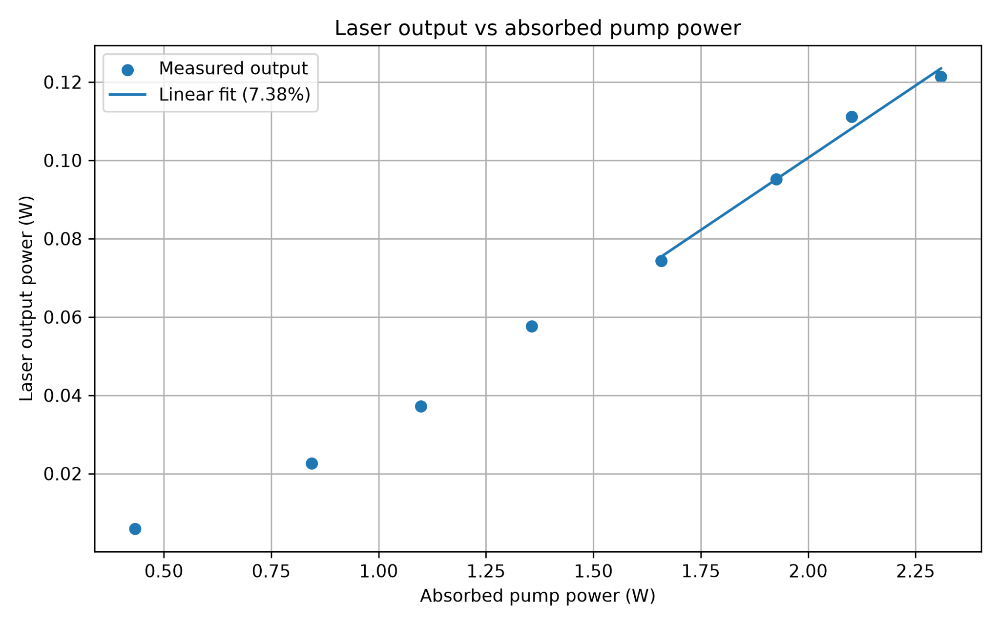

# Python-Based Semi-Automated Nd:GdVO₄ Laser Characterization

Python-based optical power acquisition and laser efficiency analysis using a **Thorlabs PM100D** power meter. This portfolio project combines USB/VISA instrument communication, a two-stage measurement workflow, CSV logging, and linear regression for slope efficiency.

## What was tested

The PM100D was connected by USB and used to acquire real power measurements and save CSV data (operator-reported hardware test). The repository includes an eight-point **Nd:GdVO₄** experimental dataset and a generated output-versus-absorbed-power plot. The calculations were checked against the exported CSV; independent verification of calibration, measurement uncertainty, and repeatability is not claimed.

**Semi-automated** means the program reads power from the instrument and processes it, while the operator manually adjusts diode current and repositions the sensor. It does **not** control the diode-current source.

## Experimental results

| Quantity | Result |
| --- | ---: |
| Gain medium | Nd:GdVO₄ |
| Power meter | Thorlabs PM100D |
| Pump wavelength configured in script | 912 nm |
| Output wavelength configured in script | 1064 nm (verify against actual laser emission) |
| Number of measurement points | 8 |
| Absorbed pump power range | 0.432–2.309 W |
| Maximum measured output power | 0.12138 W |
| Maximum pointwise optical efficiency | 5.29% |
| Slope efficiency (four highest-power points) | 7.38% |



The slope-efficiency fit uses the four highest absorbed-power points (diode currents 0.79, 0.82, 0.84 and 0.86 A), as indicated by the supplied plot. This fit region is a user selection, not an automatic determination of threshold or linearity. These values describe **this measurement run**, not an optimized performance claim for Nd:GdVO₄ lasers.

## Workflow

1. **Pump absorption reference:** for each manually set diode current, measure incident and transmitted pump powers at the pump wavelength; calculate `P_absorbed = P_incident - P_transmitted`.
2. **Laser output:** at matching currents, measure laser output power and calculate `Optical efficiency (%) = 100 × P_output / P_absorbed`.
3. **Slope efficiency:** manually select points in the above-threshold linear region and fit `P_output = slope × P_absorbed + intercept` using `numpy.polyfit`; slope efficiency is `100 × slope` percent.
4. Save timestamped CSV results and a PNG plot.

The script averages five power queries per point with a 0.2-second delay between queries, checks for duplicate or unmatched currents, and refuses to overwrite a valid pump reference when absorbed power is nonpositive.

## Repository contents

- `laser_automation.py`: two-stage acquisition and analysis program
- `experimental_data/NdGdVO4_pump_absorption_reference.csv`: experimental pump reference
- `experimental_data/NdGdVO4_laser_output.csv`: experimental laser-output data
- `figures/NdGdVO4_output_vs_absorbed_power.png`: measured data and linear fit
- `sample_data/synthetic_example.csv`: clearly labeled synthetic practice data
- `requirements.txt`: Python packages
- `.gitignore`: excludes generated run data and local environment files

## Requirements and execution

- Python 3 and packages listed in `requirements.txt`
- Thorlabs PM100D with compatible sensor and USB/VISA driver/backend (such as NI-VISA)
- Appropriate laser safety procedures and supervised instrument setup

```bash
python -m pip install -r requirements.txt
python laser_automation.py
```

Select `1` to record a pump absorption reference or `2` to measure laser output using a saved reference. The script saves newly generated files in `Laser_Experiment/` (excluded from Git to avoid accidental publication). The script requires a connected instrument; the included CSV files can be inspected without hardware.

**Important:** Confirm both configured wavelengths and the optical arrangement before measuring. Block/disable the beam safely before moving the sensor. The output wavelength of 1064 nm is the **script setting**, not independently verified from the provided CSV files.

## Limitations and future improvements

- Diode-current adjustments and sensor placement are manual.
- No automatic linear-region detection, uncertainty budget, repeated-run statistics, or automated calibration check.
- No device-independent mock mode or automated test suite yet.
- Potential next steps: measurement metadata, error bars, repeatability tests, automated regression diagnostics, and modular instrument drivers.

## Development note

This project was developed with AI-assisted coding support and tested using a real laboratory power meter. Technical claims refer to implemented features and the explicitly reported test scope.
